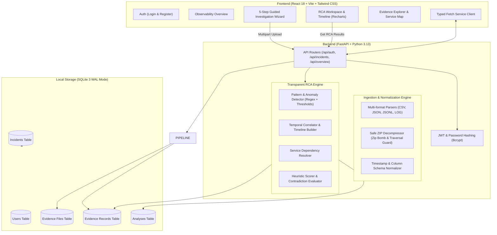

# 02 — System Architecture: IncidentIQ

## 1. Architectural Overview

IncidentIQ is built as a high-performance, local-first decoupled full-stack application designed for maximum developer ergonomics and zero external cloud dependencies.

---

## 2. Component Responsibilities

### A. Frontend Layer
- **Framework:** React 18, Vite 5, TypeScript.
- **Styling:** Tailwind CSS with deep navy background (`#080c14` / `#0a0f1d`), slate panels (`#0f172a`), borders (`#334155`), and restrained cyan/blue/amber accents.
- **Components:** Modular, accessible components inspired by shadcn/ui.
- **Icons:** Lucide-React.
- **Charts:** Recharts for time series, area charts, and severity breakdowns.
- **Proxy Configuration:** Vite dev server proxies `/api` calls directly to `127.0.0.1:8000`.

### B. Backend API Layer
- **Framework:** FastAPI with Pydantic v2 data validation.
- **Security:** Bcrypt password hashing (`rounds=10`), PyJWT token generation, parameterized queries to prevent SQL injection.
- **Ownership Isolation:** All incident queries enforce `user_id = current_user['id']` ensuring strict isolation between user accounts.
- **Concurrency:** Synchronous and async endpoints orchestrated cleanly with SQLite WAL mode.

### C. Ingestion & Normalization Layer
- **Sanitization:** File basenames are sanitized (`[^a-zA-Z0-9_\-\.]` replaced with `_`).
- **Archive Safety:** Safeguards against ZIP bombs (max 100MB uncompressed, max 25 files, max 100:1 compression ratio) and directory traversal (`..` and absolute paths stripped).
- **Provenance Retention:** Source filename and 1-based row index are stamped on every normalized record.

### D. Analysis Engine Layer
- **Pattern Matching:** Regex-based detection for connection timeouts, database deadlocks, thread pool exhaustion, and memory leaks.
- **Anomaly Detection:** Rule-based thresholds for CPU saturation (&ge;85%), memory saturation (&ge;85%), elevated latency (&ge;1000ms), and 5xx spikes (&ge;5%).
- **Heuristic Scorer:** Computes explainable weights across temporal proximity, error density, and dependency hops while subtracting contradiction penalties.

### E. Storage Layer
- **Engine:** SQLite 3 in Write-Ahead Logging (`PRAGMA journal_mode = WAL`) mode with foreign key integrity enforced (`PRAGMA foreign_keys = ON`).
- **Indexes:** Strategic B-tree indexes on `(incident_id)`, `(service)`, `(category)`, and `(timestamp)`.
